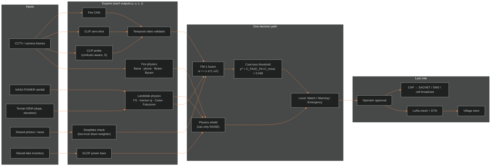
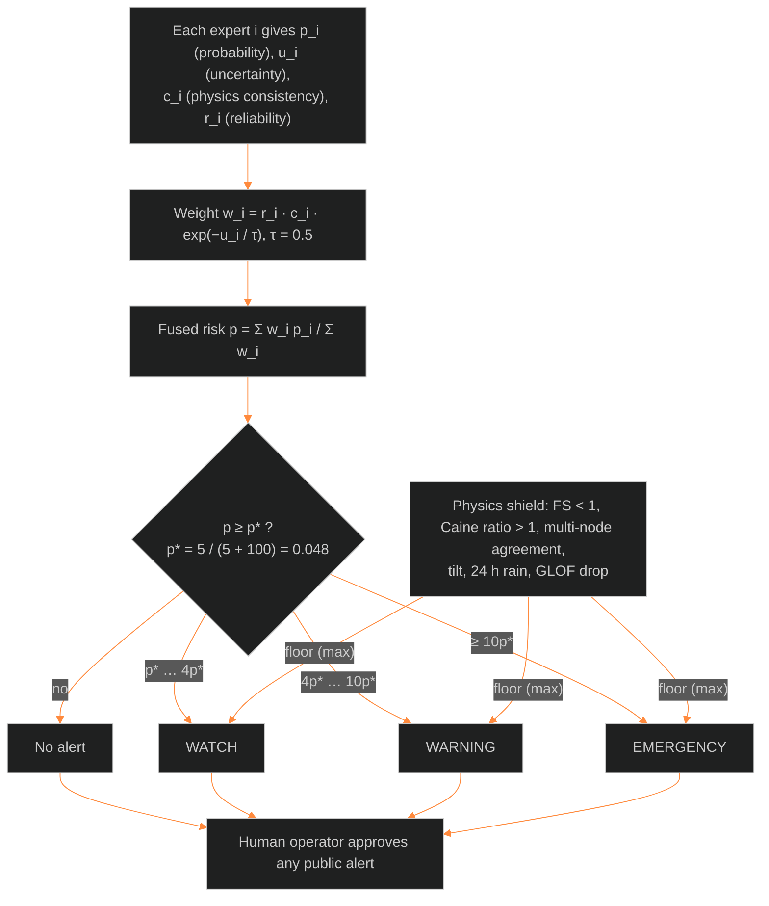
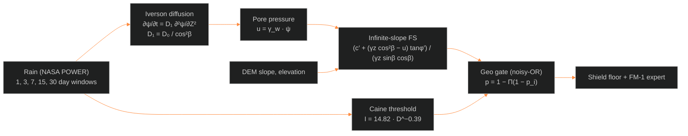
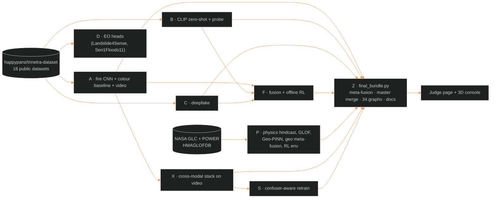

<div align="center">

# TRINETRA

### Multi-hazard early warning for the Indian Himalaya — camera AI + physics + a cost-based alarm rule

**Team Sankat Mochak** · Research prototype · Advisory only · Not field-validated

`fire` · `smoke` · `landslide` · `GLOF` · `fake-media check` · `LoRa + DTN last mile`

</div>

---

## In one line

> **Sees a disaster early. Checks it against physics. Warns only when it is worth it — and still reaches the village when the internet is down.**

Every number below was **measured by us** on public datasets with **spatial block cross-validation** (whole locations / video sequences kept
out of training), mostly over **3 seeds**. A model enters the live system only if it beats simple baselines with a 95% confidence interval.

## Headline results

| Result | What it means |
|---|---|
| **−55% false alarms** on unseen look-alikes (stack 0.35 → 0.16 at equal 90% recall); DeepFire AUC kept 0.998 → 0.997 | Confuser-aware retraining **admitted 3/3 seeds** — our first learned upgrade that passed the gate |
| **0.758 ROC-AUC** on 184 real Indian landslides, **zero training** | A 1980 physics law (Caine) + NASA rainfall already works; FM-1 fusion with rain → 0.779 |
| **+0.47** video score (detection − false alarm) with 3 models + temporal check | Best single model +0.32, our CNN alone +0.01 (49 FireSense videos, small n) |
| **0.999 ROC-AUC** on a fire dataset never used in training | Trained on D-Fire, tested on DeepFire after de-duplication |
| Deepfake 0.961 → **0.450** on new generators · RL **not deployed** (held-out LCB −0.08) · stacking **not admitted** | We report failures too; the simple rules stay in charge |

---

## System overview



## The decision, step by step



## Landslide physics chain (zero training)



## Offline last mile: LoRa + DTN


## Kaggle training pipeline (how the results were made)



---

## Scorecard (all measured results)

| Hazard | Model | Metric | Value | Gate |
|---|---|---|---|---|
| Fire / smoke (CCTV) | fire_cnn | ROC-AUC OOF / held-out | 0.768 / 0.972 | 0/3 |
| Fire / smoke (CCTV) | colorhist | ROC-AUC OOF / held-out | 0.681 | – |
| Fire / smoke (zero-shot) | zeroshot | ROC-AUC OOF / held-out | 0.917 / 1.000 | 0/1 |
| Fire / smoke (few-shot CLIP) | clip_probe | ROC-AUC OOF / held-out | 0.962 / 0.998 | 0/1 |
| Fire META-FUSION (stack: fire_cnn + zeroshot + clip_probe + colorhist) | fire_meta_fusion | ROC-AUC OOF / held-out; stack − best single AUC | 0.951 / 0.999; -0.008 | 0/3 |
| Fake media | deepfake | ROC-AUC OOF / held-out | 0.961 / 0.450 | 0/3 |
| Fire video (temporal validator) | video | false-alarm videos raw → validated | 0.893 → 0.853 | – |
| Landslide (physics, zero training) | caine_ratio | ROC-AUC spatial OOF | 0.758 | physics (no gate needed) |
| GLOF (lake area → volume) | glof_physics | exponent b (95% CI) | 1.13 (0.71-1.50) | fit |
| RL alarm policy (C_miss 100) | cql_learned vs physics_rule | return CQL / rule / oracle | -22.5 / -22.8 / -22.9 | deploy False |
| RL alarm policy (C_miss 1000) | cql_learned vs physics_rule | return CQL / rule / oracle | -200.9 / -200.0 / -200.0 | deploy False |
| RL alarm policy (C_miss 5000) | cql_learned vs physics_rule | return CQL / rule / oracle | -486.8 / -478.1 / -478.5 | deploy False |
| Landslide (Geo-PINN) | geo_pinn | ROC-AUC OOF / held-out | 0.716 | 0/1 |
| Landslide META-FUSION (physics + rain, FM-1) | geo_fusion | ROC-AUC OOF (calibrated FM-1) | 0.779 | 0/3 |
| RL on fused alerts | offline_rl | gain vs rule (LCB) | +0.615 (+0.237) | deploy 3/3 |
| RL on REAL-paired fire meta-fusion | offline_rl_real | gain vs rule (LCB) | +1.076 (+0.773) | deploy 3/3 |
| RL HELD-OUT (block folds, true reward) | offline_rl_heldout | CQL gain vs rule / vs tuned rule (LCB) | +0.485 (-0.081) / -0.015 (-0.433) | deploy 0/3 |
| Fire CROSS-MODAL (per-frame stack + temporal validator, FireSense) | crossmodal | video J (detect − FA): stack / clip_probe / fire_cnn | +0.467 / +0.320 / +0.008 | – |
| Fire CONFUSER-AWARE retrain (leave-one-confuser-set-out) | stress | FA at equal recall 0.90: probe base → conf / stack base → conf; DeepFire AUC base → conf | 0.427 → 0.319 / 0.346 → 0.157; 0.998 → 0.997 | 3/3 |
| Fusion (all experts) | p_zeroshot | value score (best rule) / FM-1 | 0.108 / 0.005 | – |

*Gate* = admitted / deploy verdict across seeds (Rule 16: must beat climatology and logistic baselines on cost-weighted value with a 95% CI).
Source: `results/master_merged/MASTER_RESULTS.md`. D (EO heads) output was not available for the final merge.

---

## Graphs

### Results
|  |  |
| **R9** Hard-negative retrain cuts false alarms on unseen look-alikes | **R7** Three models + temporal check beat one on video |
|  |  |
| **R4** Landslide: physics with zero training | **R1** Fire ROC: our folds vs a never-seen dataset |
|  |  |
| **R0** Every ROC-AUC in one chart | **R6** Who survives a new data source |
|  |  |
| **R2** Calibration after temperature scaling | **R3** Base-rate correction (proposal) |
|  |  |
| **R5** RL on held-out folds | **R8** False alarms per confuser set |

### Deeper analysis
|  |  |
| **G09** Caine line on real Indian events | **G08** Landslide days vs normal days |
|  |  |
| **G04** Where false alarms come from | **G06** Ways of combining fire models |
|  |  |
| **G10** GLOF power laws (HMAGLOFDB) | **G11** RL simulator policies |
|  |  |
| **G13** Score distributions | **G14** Confusion matrices |

### Physics explainers (computed with the repo's own functions)
|  |  |
| FS falls as pore pressure rises | Iverson pressure-head diffusion |
|  |  |
| Flame height, Byram number, flicker | Where p* comes from |
|  |  |
| LoRa range vs airtime | Fresnel zone on real Chamoli terrain |

All 34 graphs with Hinglish explanations: [`results/final/GRAPHS_EXPLAINED.md`](TRINETRA/results/final/GRAPHS_EXPLAINED.md).

---

## What did not work (and why we keep it in the README)

| Attempt | Result | Decision |
|---|---|---|
| Deepfake detector (CIFAKE) | 0.961 on its source, **0.450** on new generators | Kept only as a low-trust down-weighter; never raises or cancels an alarm |
| Learned alarm policy (offline RL, CQL) | +1.08 in-sample, held-out lower bound **−0.08** | Not deployed; cost rule stays |
| Stacking all fire models | −0.008 AUC vs best single model | Not admitted; FM-1 kept |
| Geo-PINN | 0.716 AUC < Caine 0.758 < rain logistic 0.781 | Research only |

---

## Run it

```bash
# from the repository root
pnpm install
pnpm demo:offline        # judge page on http://localhost:4173  ·  live 3D console at /#console
pnpm gateway             # optional: live mode, streams the repo's Python fuse() + decide()
python3 TRINETRA/trinetra/demo.py # Python end-to-end: fire + geo cycles through the single decide()
```
Re-make every result from the Kaggle outputs: `TRINETRA_Z_FINAL.ipynb` (CPU, 5–10 min) or
`python TRINETRA/trinetra/kaggle/final_bundle.py --zips out_*.zip --out FINAL`, then `python3 tools/import_final.py TRINETRA_FINAL.zip`.

## Repository map

| Path | What |
|---|---|
| `src/judge/` · `src/console/` | Judge page (default) and 3D command console (`/#console`), React + Vite |
| `tools/` | figure, data-pack and gateway scripts (`make_figures.py`, `import_final.py`, `mock_gateway.py`) |
| `TRINETRA/trinetra/src/trinetra/` | Python package: `ws1a_firephys`, `ws1b_geophys`, `ws2_deepfake`, `ws3_alert` (CAP, siren, LoRa, DTN), `ws5_fusion_rl` (FM-1, shield, decide, RL env), `deep/` (PyTorch models), `eval/`, `pipeline/orchestrator.py` |
| `TRINETRA/trinetra/kaggle/` | training + evaluation scripts, `final_bundle.py`, `extra_figures.py`, `merge_all_results.py` |
| `TRINETRA/exports/kaggle_notebooks/` | self-contained Kaggle notebooks A, B, C, D, F, P, X, S, Z + run order |
| `TRINETRA/results/` | measured reports; `master_merged/` = final scorecard |
| `TRINETRA/figures_final/` | all final graphs |
| `TRINETRA/docs/19_TRINETRA_EXPLAINED/` | Hinglish book; `PHYSICS_FROM_ZERO/` = physics derivations from zero (P00–P06) |
| `TRINETRA/docs/20_FINAL/` | `DATASETS_USED.csv/.tsv`, landslide feature table, code + integration guide, LoRa + DTN brief with costs |

## Datasets
18 public datasets (D-Fire, DeepFire, FIRE, Home-fire, Weather, Candle flames, Intel scenes, FireSense, CIFAKE, StyleGAN faces, AI-art,
NASA Global Landslide Catalog, NASA POWER, terrain DEM, HMAGLOFDB v4, Landslide4Sense, Sen1Floods11, Hephaestus). Features, labels,
sizes, splits and licences: [`docs/20_FINAL/DATASETS_USED.csv`](TRINETRA/docs/20_FINAL/DATASETS_USED.csv). Bundle on Kaggle: `happyparsi/trinetra-dataset`.

## Cost (planning, not a tender)
One valley (1 gateway + 3 ridge relays + 5 village sirens) ≈ **₹1.2–1.4 lakh**. Uttarakhand priority network ≈ **₹1.5–3.0 crore** in
year one = 0.15–0.29% of the state's annual disaster-management allocation. Details: [`docs/20_FINAL/LORA_DTN_HINGLISH.md`](TRINETRA/docs/20_FINAL/LORA_DTN_HINGLISH.md).

---

## Team Sankat Mochak — roles

| Member | Role | Owns |
|---|---|---|
| **Member 1 (team lead)** | **Physics Research Lead** | All physics models and their derivations: landslide (FS, Iverson, Caine, Fukuzono, geo gate), fire (Heskestad, McCaffrey, Byram, flicker), decision physics (cost-loss p*, noisy-OR, shield), radio (link budget, Fresnel), GLOF power laws, Geo-PINN loss; `PHYSICS_FROM_ZERO/` book; physics graphs; physics unit tests / golden values; physics Q&A for judges |
| **Member 2** | ML & Evaluation Lead | Fire CNN, CLIP zero-shot / probe, deepfake, confuser-aware retrain (S), cross-modal stack (X); Kaggle notebooks and run order; spatial-CV protocol, calibration, admission gate; scorecard and result graphs |
| **Member 3** | Fusion, Alerts & Field Systems Lead | FM-1 fusion, shield and `decide()`; offline RL gate; CAP / SACHET path; LoRa + DTN last mile, relay placement, hardware BOM and cost model; IoT plan and safety / legal review |
| **Member 4** | Product, Demo & Story Lead | Judge page and 3D console, live gateway demo, slides and live-flow animation; datasets catalogue; README, demo runbook, final pitch and timing |

---

<sub>TRINETRA is a research prototype. Advisory only; not an official warning system. Every public alert needs human approval. All map
locations in the demo are synthetic. Results are on small public datasets and are not field-validated.</sub>
