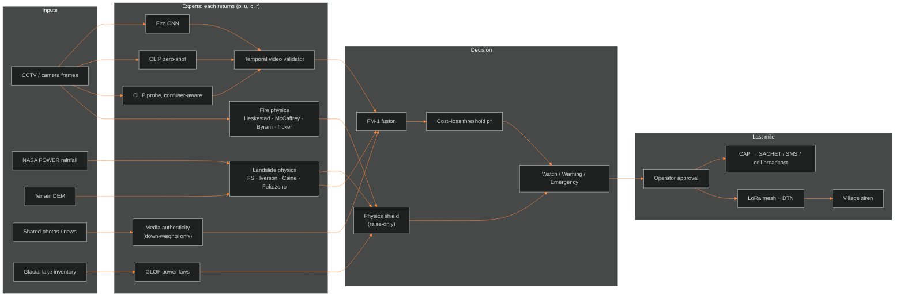
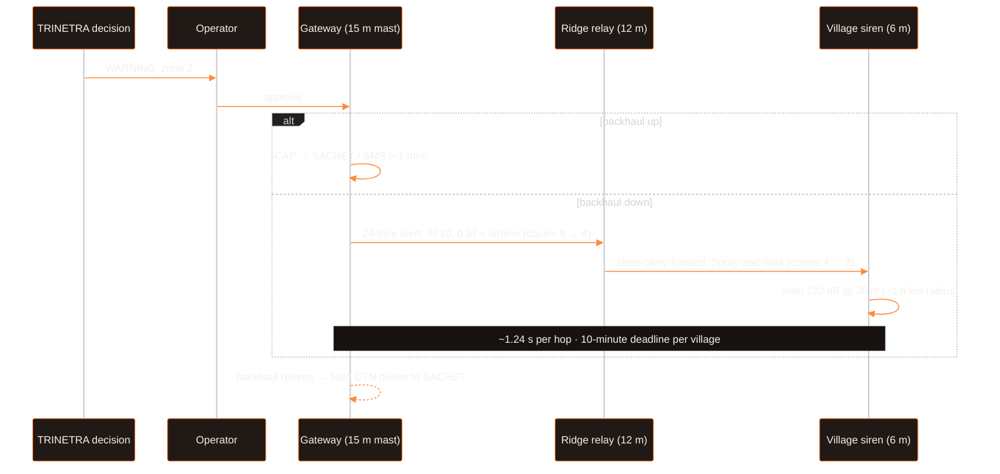
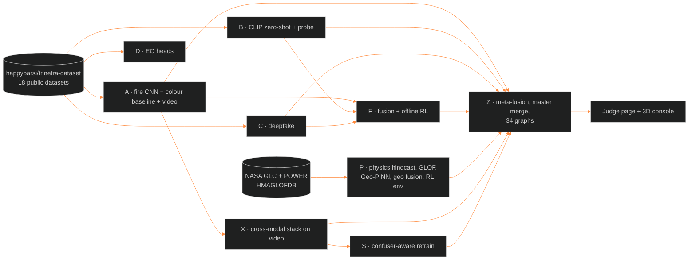

<div align="center">

# TRINETRA

**Physics-gated, cost-sensitive multi-hazard early warning for the Indian Himalaya,
with an offline LoRa + DTN last mile**

Team Sankat Mochak — Mohit Kaintura · Paras Rawal · Akansha Rawat

Research prototype · advisory only · not field-validated

[Results](#6-results) · [Method](#4-method) · [Negative results](#8-what-did-not-work) · [Reproduce](#12-reproducing-every-number) · [Demo](#13-running-the-demo) · [Kaggle dataset](https://www.kaggle.com/datasets/happyparsi/trinetra-dataset)

</div>

---

## Abstract

Early-warning systems for mountain hazards break in three ways. Detectors fire on look-alikes (fog, steam, sunset glare, a diya)
until people stop listening. Labelled training data barely exists for most Indian districts. And the mobile network goes down at the
moment the warning is needed. TRINETRA tackles each of these separately.
(i) Each detector is an *expert* that reports a probability, an uncertainty, a physics-consistency score and a reliability. They are fused
by a single rule (FM-1). A physics *shield* can raise the alert level but can never lower it.
(ii) The alarm threshold is not tuned by hand. It comes from a cost–loss argument, $p^\ast = C_{FA}/(C_{FA}+C_{miss})$, so an
authority sets prices, not cut-offs.
(iii) Approved alerts leave over CAP when the internet is up, and over a store-carry-forward LoRa mesh when it is not.

We evaluate on 18 public datasets using spatial-block and group cross-validation, mostly over three seeds. No learned component enters
the live path unless it beats climatology and a recalibrated logistic baseline on cost-weighted value, with a 95% confidence interval.
The key results:

- **Landslides without training.** On 184 real rain-triggered landslides in the Indian Himalaya, the 1980 Caine intensity–duration
  threshold reaches **ROC-AUC 0.758** with no fitting. A trained rain model reaches 0.781.
- **Fewer false alarms on look-alikes.** Confuser-aware retraining of a CLIP probe cuts false alarms on *unseen* confuser families from
  **0.35 to 0.16** for the stacked model, at equal 90% recall. It passed the admission gate on 3 of 3 seeds.
- **Video beats single frames.** On 49 videos, three per-frame experts plus a temporal validator reach a video score of
  **J = +0.467**, against +0.320 for the best single model.
- **Negative results.** The deepfake detector collapses on unseen generators (0.961 → 0.450). Offline RL does not survive held-out
  evaluation, and stacking does not beat the best single model. All three are reported here, and none of them is deployed.

---

## Contents

1. [Problem](#1-problem)
2. [Contributions](#2-contributions)
3. [System](#3-system)
4. [Method](#4-method)
5. [Experimental protocol](#5-experimental-protocol)
6. [Results](#6-results)
7. [Ablations](#7-ablations)
8. [What did not work](#8-what-did-not-work)
9. [Threats to validity](#9-threats-to-validity)
10. [Offline last mile: LoRa + DTN](#10-offline-last-mile-lora--dtn)
11. [Deployment, cost and safety](#11-deployment-cost-and-safety)
12. [Reproducing every number](#12-reproducing-every-number)
13. [Running the demo](#13-running-the-demo)
14. [Repository map](#14-repository-map)
15. [Data](#15-data)
16. [Roadmap](#16-roadmap)
17. [Team](#17-team)
18. [Citation](#18-citation)

---

## 1. Problem

India now records extreme weather on most days of the year. In January to September 2024 it was 255 of 274 days, with 3,238 deaths
and about 2.36 lakh houses damaged (CSE / Down To Earth, *State of Extreme Weather 2024*). ISRO-NRSC's *Landslide Atlas of India*
(2023) lists 80,933 landslides between 1998 and 2022, and puts Rudraprayag and Tehri in Uttarakhand among the most exposed districts.
The 2013 Uttarakhand disaster alone was assessed at ₹3,964 crore in damage and recovery needs (JRDNA), ₹2,710 crore of it in roads
and bridges.

Where warning works, the difference is stark: about 10,000 deaths in the 1999 Odisha super-cyclone against 64 in Fani (2019). For
landslides, GLOFs and forest fire in the hills, warning is still weak. The literature points to recurring failure patterns
(full list with sources: [`TRINETRA/docs/17_EXISTING_SYSTEMS_AND_FAILURES.md`](TRINETRA/docs/17_EXISTING_SYSTEMS_AND_FAILURES.md)):

| Pattern | What goes wrong |
|---|---|
| Alert fatigue | A single detector with a fixed threshold fires on look-alikes, and people learn to ignore it |
| Label scarcity | Models trained elsewhere meet Indian scenes, weather and terrain they never saw |
| Inflated evaluation | Frames from the same video, or the same hillside, sit in both train and test |
| Miscalibration | "90% sure" is not 90% |
| Connectivity collapse | Towers, power and fibre fail first, so cloud-only alerting stops |
| Misinformation | Old or synthetic media circulates during response |
| Unvalidated policies | RL agents shown without any baseline comparison |

---

## 2. Contributions

Claims follow a ladder: C1 design only, C2 implemented and unit-tested, **C3 implemented and measured by us**, C4 matches a published
result on a matched protocol. **We make no C4 claim.** Everything in bold below is C3.

1. **One decision path for every hazard.** Fire, smoke, landslide, GLOF and media-trust experts share one fusion rule, one
   monotone physics shield and one cost-derived threshold. Adding a hazard means adding an expert, not a new system.
2. **Zero-training landslide physics on real Indian events.** Caine I–D reaches 0.758 ROC-AUC and Iverson + infinite-slope ΔFS
   reaches 0.750, over 101 spatial blocks.
3. **Confuser-aware retraining with a leave-one-confuser-family-out protocol.** The admission gate passed on 3/3 seeds, with no measurable
   loss on a dataset never used in training (DeepFire AUC 0.998 → 0.997).
4. **Cross-modal temporal validation for video.** The stack plus validator beats every single expert on held-out videos.
5. **A strict admission gate that rejected most of our own models,** including a Geo-PINN, offline RL and full stacking. It is
   enforced in CI (6/6 honesty gates, 128/128 unit tests).
6. **A terrain-aware offline last mile.** LoRa links are checked against the real DEM (Fresnel zone plus earth bulge). Alerts move by
   Binary Spray-and-Wait DTN, and CAP is flushed to SACHET when the backhaul returns (C2, simulated).

---

## 3. System



The core (`fuse()`, `decide()`, shield, CAP builder, DTN) is numpy-only and runs offline on CPU. PyTorch is used only for the vision
and EO experts.

---

## 4. Method

### 4.1 Experts

Each expert $i$ returns a tuple $(p_i, u_i, c_i, r_i)$:

| Symbol | Meaning | Source |
|---|---|---|
| $p_i \in [0,1]$ | calibrated event probability | cross-fitted temperature scaling on OOF scores |
| $u_i \ge 0$ | uncertainty | ensemble spread; for single-score experts $u_i = \tfrac12 H_2(p_i)$ (binary entropy) |
| $c_i \in [0,1]$ | physics consistency | agreement with the physics expert for the same site and time |
| $r_i \in [0,1]$ | reliability | prior trust per source; media trust is discounted, $r' = r\,(1-p_{fake})$ |

| Expert | Model | Trained on |
|---|---|---|
| `fire_cnn` | compact CNN, 3 seeds | D-Fire |
| `colorhist` | colour-histogram baseline | D-Fire |
| `zeroshot` | open_clip ViT-L-14 (`laion2b_s32b_b82k`), prompt ensemble | none |
| `clip_probe` | linear probe on frozen CLIP features | D-Fire (+ confuser negatives in S) |
| `video` | temporal validator: confirm only if ≥ 3 of the last 5 frames exceed the threshold (persistence) | rule-based |
| `deepfake` | AuthenticityNet: frequency + spatial branches | CIFAKE |
| `caine_ratio`, `dfs` | Caine I–D; Iverson + infinite slope | none (physics) |
| `geo_pinn` | MLP with a physics-residual loss | NASA GLC (research only) |

### 4.2 Fusion (FM-1)

$$
w_i = r_i\,c_i\,e^{-u_i/\tau},\qquad \hat p = \frac{\sum_i w_i\,p_i}{\sum_i w_i},\qquad \tau = 0.5
$$

If experts disagree strongly, so that the conflict-aware uncertainty $U^\ast$ exceeds the abstain threshold, the system returns
**Abstain: human review** instead of a level. Missing experts drop out of both sums, and the fused output is re-calibrated per
availability pattern, because calibrated members do not make a calibrated ensemble. Alternatives (PHARAOH, median, max, noisy-OR,
stacking) are implemented and compared in [§7](#7-ablations).

### 4.3 Threshold from cost, not tuning

For a false-alarm cost $C_{FA}$ and a miss cost $C_{miss}$, the expected-cost-minimising rule alarms when

$$
\hat p \ \ge\ p^\ast = \frac{C_{FA}}{C_{FA}+C_{miss}} = \frac{5}{5+100} = 0.0476 .
$$

Levels are multiples of $p^\ast$: **Watch** for $[p^\ast, 4p^\ast)$, **Warning** for $[4p^\ast, 10p^\ast)$ and **Emergency** for
$\ge 10p^\ast$. Real deployments have a much lower event base rate $\pi'$ than training data ($\pi$), so the proposed prior-shift
correction is

$$
p' = \frac{p\,\pi'/\pi}{p\,\pi'/\pi + (1-p)(1-\pi')/(1-\pi)} .
$$

This is marked PROPOSED, and its effect on alert volume is shown in R3.

### 4.4 Physics shield (raise-only)

The shield computes a level floor from physical evidence. These signals can only raise the level:
- factor of safety $FS < 1$
- Caine ratio $> 1$
- multi-node agreement
- tilt-rate excess
- 24 h rain
- an abrupt GLOF lake-level drop

The final level is $\max(\text{fused}, \text{shield})$. By construction, a model that fails silently cannot suppress a physically
indicated alarm.

### 4.5 Landslide physics (no training)

Iverson (2000) pressure-head diffusion, driven by NASA POWER rain over 1, 3, 7, 15 and 30 day windows:

$$
\frac{\partial \psi}{\partial t} = D_1\,\frac{\partial^2 \psi}{\partial Z^2},\qquad D_1 = \frac{D_0}{\cos^2\beta},\qquad u = \gamma_w\,\psi
$$

Infinite-slope factor of safety, with cohesion $c'$ back-analysed so that dry slopes are stable. Without this step, the assumed soil
gave $FS<1$ on dry Himalayan slopes, which would mean a permanent alarm:

$$
FS = \frac{c' + (\gamma z\cos^2\beta - u)\tan\phi'}{\gamma z \sin\beta\cos\beta},\qquad \Delta FS = FS_{dry} - FS(t)
$$

Caine (1980) intensity–duration threshold, $I = a\,D^{-b}$ (mm/h, h), with the repo constants $a = 14.0$, $b = 0.39$ and no
local fitting, used as the ratio $I_{obs}/I_{Caine}$. Fukuzono's
inverse-velocity method extrapolates $1/v \to 0$ to estimate time-to-failure from tilt series. Geo experts are combined by noisy-OR,
$p = 1-\prod_i (1-p_i)$.

### 4.6 Fire physics (consistency features, not a solver)

| Relation | Form | Use |
|---|---|---|
| Heskestad flame height | $L = 0.235\,\dot Q^{2/5} - 1.02\,D$ | is the apparent flame size plausible for the camera geometry? |
| McCaffrey plume | centreline temperature regimes vs $z/\dot Q^{2/5}$ | plume-temperature prior |
| Puffing frequency | $f \approx 1.5/\sqrt{D}$ Hz (Strouhal scaling) | flicker band for the video validator, aliasing-aware |
| Byram intensity | $I_B = H\,w\,R$ | spread-regime context for the scenario engine |

A full fire PINN was rejected for on-device use because of stiffness, spectral bias and non-identifiability. Physics enters as soft
features with fallback to the established parent relation.

### 4.7 GLOF

Power laws are fitted on HMAGLOFDB v4: $V = aA^{b}$ and $Q_p = cV^{d}$. They give a volume and peak discharge from lake area, which
feeds the shield.

Derivations from first principles, with worked numbers:
[`TRINETRA/docs/19_TRINETRA_EXPLAINED/PHYSICS_FROM_ZERO/`](TRINETRA/docs/19_TRINETRA_EXPLAINED/PHYSICS_FROM_ZERO/) (P00–P06).

---

## 5. Experimental protocol

- **Splits.** For geo data, *spatial block* CV is used: whole locations are held out, giving 101 blocks on the large set. Images use
  group CV, perceptual-hash de-duplication, grouping of augmented copies, and cross-dataset de-duplication. Six data-leak bugs were
  caught this way before training (`docs/BUG_STATUS.md`, B-17 to B-22). Video uses whole-sequence hold-out.
- **Held-out sources.** Fire experts are trained on D-Fire and tested on DeepFire, FIRE and Home-fire after de-duplication against the
  training set.
- **Confuser families.** Three families serve as hard negatives:
  - weather: fog/smog, sandstorm, lightning, rain
  - small benign flames: candle, lighter, matchstick
  - ordinary scenes: street, building, forest, mountain
- **Seeds.** 3 wherever compute allowed. One seed is used for zero-shot, since that is deterministic up to prompts.
- **Calibration.** Cross-fitted temperature scaling, reported as ECE.
- **Admission gate (Rule 16).** A learned expert is admitted only if it beats *both* climatology and a recalibrated logistic
  baseline on cost-weighted value at $p^\ast$, with a 95% bootstrap confidence interval that excludes zero. Physics experts need no
  gate because nothing is fitted.
- **RL gate.** A policy is deployed only if the 95% lower confidence bound (LCB) of its paired gain over the rule is $> 0$ on held-out
  block folds with the true reward.

---

## 6. Results

All numbers are ours, measured on the prototype data pack. They are not comparable with full-benchmark papers.
Source of truth: [`TRINETRA/results/master_merged/MASTER_RESULTS.md`](TRINETRA/results/master_merged/MASTER_RESULTS.md) and
[`TRINETRA/docs/NUMBERS_REGISTER.md`](TRINETRA/docs/NUMBERS_REGISTER.md).

### 6.1 Scorecard

| Hazard | Expert | Metric | Value | Gate |
|---|---|---|---|---|
| Fire / smoke | `fire_cnn` | ROC-AUC OOF / held-out | 0.768 / 0.972 | 0/3 |
| Fire / smoke | `colorhist` | ROC-AUC OOF | 0.681 | – |
| Fire / smoke | `zeroshot` | ROC-AUC OOF / held-out | 0.917 / 1.000 | 0/1 |
| Fire / smoke | `clip_probe` | ROC-AUC OOF / held-out | 0.962 / 0.998 | 0/1 |
| Fire / smoke | meta-fusion stack (all four) | ROC-AUC OOF / held-out; Δ vs best single | 0.951 / 0.999; −0.008 | 0/3 |
| Fire / smoke | **confuser-aware retrain** | FA at recall 0.90, stack base → conf | **0.346 → 0.157** | **3/3** |
| Fire video | **cross-modal + temporal** | J = detect − FA: stack / probe / CNN | **+0.467 / +0.320 / +0.008** | – |
| Fire video | temporal validator alone | false-alarm videos raw → validated | 0.893 → 0.853 | – |
| Fake media | `deepfake` | ROC-AUC OOF / unseen generators | 0.961 / 0.450 | 0/3 |
| Landslide | **Caine ratio, no training** | ROC-AUC spatial OOF | **0.758** | physics |
| Landslide | Geo-PINN | ROC-AUC OOF | 0.716 | 0/1 |
| Landslide | FM-1 physics + rain | ROC-AUC OOF, calibrated | 0.779 | 0/3 |
| GLOF | power law $V=aA^b$ | $b$ (95% CI), n = 21 | 1.13 (0.71–1.50) | fit |
| Alarm policy | CQL vs physics rule, $C_{miss}=100$ | return CQL / rule / oracle | −22.5 / −22.8 / −22.9 | not deployed |
| Alarm policy | held-out block folds | CQL gain vs rule (LCB) | +0.485 (−0.081) | 0/3 |

*Gate* means admitted or deployed, out of the seeds run. Only one learned upgrade passed: the confuser-aware retrain. The fire
experts look strong on AUC but were not admitted, because the gate scores value at a very low threshold ($p^\ast = 0.048$), where false
alarms dominate. That gap is exactly what the confuser-aware retrain addresses.

### 6.2 Landslides: 184 events, 552 control days, 101 blocks

NASA Global Landslide Catalog, rain-triggered events inside 29–33°N, 76–81°E, each paired with same-site monsoon control days.

| Model | Fitted? | ROC-AUC (spatial OOF) |
|---|---|---|
| Caine I–D ratio | no | **0.758** |
| Iverson + FS, ΔFS | no | 0.750 |
| Repo geo gate, back-analysed $c'$ | no | 0.712 |
| Logistic on physics features | yes | 0.773 |
| Logistic on rain windows (data baseline) | yes | 0.781 |
| Logistic rain + physics (hybrid), ECE 0.030 | yes | 0.780 |

Physics minus rain is **−0.007 [−0.024, +0.011]** (95% block-bootstrap CI) on the large set. On the small Chamoli tile (112 rows,
15 blocks) it was +0.095 [+0.052, +0.144]. That gain disappeared with 6.5× more data, and we report it as a non-result. Physics
matters here for a different reason: it works with no labels at all, which is the situation in most Indian districts.

### 6.3 Figures

All 34 figures are rendered at the same width with one consistent caption block. Result figures (R) come from measured OOF and
held-out scores; extra analyses (G) use the same runs; physics explainers (P) are computed with the repository's own functions,
not drawn by hand. Hinglish notes for every figure: [`TRINETRA/results/final/GRAPHS_EXPLAINED.md`](TRINETRA/results/final/GRAPHS_EXPLAINED.md).

**Figure index**

| # | Figure | One-line takeaway |
|---|---|---|
| R0 | [All ROC-AUCs](#fig-r0) | Fire and CLIP experts hold on new data; deepfake does not |
| R1 | [Fire ROC, OOF vs held-out](#fig-r1) | CLIP probe and stack dominate; CNN lags |
| R2 | [Calibration](#fig-r2) | Temperature scaling brings curves to the diagonal, so $p^\ast$ is meaningful |
| R3 | [Alert volume vs base rate](#fig-r3) | Prior-shift correction removes most false alarms (proposal) |
| R4 | [Landslide AUC](#fig-r4) | Zero-training physics ≈ 0.75, fitted rain model 0.78 |
| R5 | [Offline RL held-out](#fig-r5) | RL does not beat the tuned rule |
| R6 | [Generalisation gap](#fig-r6) | Deepfake falls 0.96 → 0.45 on new generators |
| R7 | [Cross-modal video](#fig-r7) | Stack + temporal validator: J = +0.47 |
| R8 | [False alarms per confuser](#fig-r8) | Small flames are the hardest negatives |
| R9 | [Confuser-aware retrain](#fig-r9) | Stack FA 0.35 → 0.16 at equal recall, admitted 3/3 |
| G01–G14 | [Extra analyses](#extra-analyses-g01g14) | Seeds, metrics, fusion rules, features, GLOF, RL |
| P01–P10 | [Physics explainers](#physics-explainers-p01p10) | FS, Iverson, Caine, Fukuzono, fire, cost-loss, LoRa, Fresnel, noisy-OR |

#### Measured results (R0–R9)

<a id="fig-r0"></a>
##### R0 — Every measured ROC-AUC in one chart

<p align="center"></p>

- **What it shows:** ROC-AUC of every expert. Orange is same-source OOF under spatial/group CV; blue is a dataset never used in training.
- **How to read it:** 0.5 is chance. A long orange bar with a short blue bar means the model learned its source, not the task.
- **Result:** fire experts and the CLIP probe keep their AUC on the held-out source; the deepfake detector collapses.
- **Caveat:** AUC is threshold-free. Admission is decided on cost-weighted value at $p^\ast$, which is much stricter (see §6.1).

<a id="fig-r1"></a>
##### R1 — Fire ROC curves: OOF (left) vs never-seen dataset (right)

<p align="center"></p>

- **What it shows:** ROC curves for `fire_cnn`, `colorhist`, `zeroshot`, `clip_probe` and the stack, on D-Fire OOF and on DeepFire after de-duplication.
- **How to read it:** the closer a curve hugs the top-left corner, the better. The left edge (low FPR) is what matters for alarms.
- **Result:** CLIP probe and stack are highest (OOF 0.962 / 0.951); `fire_cnn` is lowest of the learned models (0.768 OOF, 0.972 held-out).
- **Caveat:** DeepFire is a clean forest set, so near-perfect held-out curves are not a CCTV field claim.

<a id="fig-r2"></a>
##### R2 — Calibration after cross-fitted temperature scaling

<p align="center"></p>

- **What it shows:** reliability diagram: predicted probability (x) vs observed fire frequency (y).
- **How to read it:** the diagonal is perfect calibration. Above it the model is under-confident; below it, over-confident.
- **Result:** after temperature scaling the curves sit close to the diagonal, which is what makes a cost-derived threshold usable.
- **Caveat:** the temperature is fitted on other folds only (cross-fit), so this is not in-sample calibration.

<a id="fig-r3"></a>
##### R3 — Alert volume vs deployment base rate (prior-shift correction)

<p align="center"></p>

- **What it shows:** false-alarm rate on non-fire images (red) and detection rate on fire images (green) at the WARNING cut ($4p^\ast$), as the deployment base rate used for the prior-shift correction (§4.3) goes from the training prior of 55% down to 0.1%. Real per-image stack probabilities (OOF).
- **How to read it:** log x-axis; the dotted line on the right is the repository default (no correction).
- **Result:** at the default, false alarms ≈ 0.32 and detection ≈ 0.95. At a 1% base rate, false alarms ≈ 0 and per-image detection ≈ 0.6. A real fire is seen over many frames, so incident-level detection stays high in the console simulation.
- **Caveat:** PROPOSED, not the repository default.

<a id="fig-r4"></a>
##### R4 — Landslide: zero-training physics vs fitted models (184 events, 101 blocks)

<p align="center"></p>

- **What it shows:** spatial-OOF ROC-AUC of Caine, ΔFS and the geo gate (blue, nothing fitted), against rain logistic, FM-1 fusion and the Geo-PINN (red).
- **How to read it:** blue bars need no labels at all; the gap to the fitted bars is the price of having no training data.
- **Result:** Caine 0.758, ΔFS 0.750, rain logistic 0.781, FM-1 0.779, Geo-PINN 0.716.
- **Caveat:** case-control design, so the base rate is artificial. ROC-AUC is the honest headline here, not precision.

<a id="fig-r5"></a>
##### R5 — Offline RL on held-out block folds

<p align="center"></p>

- **What it shows:** reward per image for CQL, the fixed cost rule, a tuned rule and always-alarm, evaluated with the true reward on held-out folds.
- **How to read it:** higher is better. Error bars are across seeds.
- **Result:** CQL gain vs rule +0.485 with LCB −0.081; vs tuned rule −0.015 (LCB −0.433). Deploy 0/3.
- **Caveat:** the earlier +1.08 came from in-sample off-policy evaluation and was optimistic. This figure replaces it.

<a id="fig-r6"></a>
##### R6 — Generalisation gap: same source vs new source

<p align="center"></p>

- **What it shows:** paired bars of same-source vs new-source AUC per expert.
- **How to read it:** the vertical drop between the two bars is the generalisation gap.
- **Result:** fire experts barely move; deepfake drops from 0.961 to 0.450, below chance.
- **Consequence:** the deepfake expert is a reliability down-weighter only and can never raise or cancel an alarm.

<a id="fig-r7"></a>
##### R7 — Cross-modal video: detection minus false alarm (49 FireSense videos)

<p align="center"></p>

- **What it shows:** video-level $J$ = detection rate − false-alarm rate for each stream after the temporal validator (≥ 3 of 5 frames).
- **How to read it:** $J = 1$ is perfect, $J = 0$ is no better than always or never alarming.
- **Result:** stack +0.467, CLIP probe +0.320, `fire_cnn` +0.008. Combining experts helps *across time*, where it did not help on single images.
- **Caveat:** 49 videos. Read the numbers as counts, not as a precise rate.

<a id="fig-r8"></a>
##### R8 — False-alarm rate per confuser family, per stream

<p align="center"></p>

- **What it shows:** false-alarm rate on weather, small benign flames and ordinary scenes for each expert, the stack and a 2-of-3 vote.
- **How to read it:** lower is better. Every image here is a true negative.
- **Result:** small flames (candle, lighter, match) are the hardest family for every model, because they are real flames, just not dangerous ones.
- **Consequence:** this figure is the motivation for R9.

<a id="fig-r9"></a>
##### R9 — Confuser-aware retrain on unseen look-alikes (leave-one-family-out)

<p align="center"></p>

- **What it shows:** false-alarm rate at equal 90% recall on a confuser family the model never saw, before (base) and after (conf) hard-negative training on the other two families.
- **How to read it:** each pair of bars is one model; the drop is the effect of retraining on a *different* kind of look-alike.
- **Result:** CLIP probe 0.427 → 0.319, stack 0.346 → 0.157 (−55%). DeepFire AUC 0.998 → 0.997. Admitted on 3/3 seeds, the only learned upgrade that passed the gate.
- **Caveat:** the "ordinary scenes" family fails the gate on its own (CI crosses 0, §7.1) because false alarms there were already near zero.

#### Extra analyses (G01–G14)

<a id="fig-g01"></a>
##### G01 — ROC-AUC per seed

<p align="center"></p>

- **What it shows:** one dot per seed, black line at the mean, for every expert.
- **Result:** tight clusters mean stable training. CLIP probe and fire meta-fusion sit near 0.95; the colour baseline near 0.68; landslide models 0.72–0.78, limited by coarse rain and DEM features.

<a id="fig-g02"></a>
##### G02 — ROC-AUC vs PR-AUC vs recall at 5% FPR

<p align="center"></p>

- **What it shows:** three metrics side by side per expert.
- **How to read it:** ROC-AUC measures ranking; PR-AUC measures how often a "fire" call is right; recall@FPR 5% answers the operational question *"if only 5 in 100 alarms may be false, how many real fires do we catch?"*
- **Result:** CLIP probe and stack exceed about 0.8 recall at 5% FPR; the colour baseline is far lower.

<a id="fig-g03"></a>
##### G03 — Generalisation across sources

<p align="center"></p>

- **What it shows:** in-source vs new-source performance, with the deepfake detector on CIFAKE vs unseen generators.
- **Result:** fire models hold on DeepFire forest photos; deepfake falls from 0.96 to 0.45.

<a id="fig-g04"></a>
##### G04 — Where false alarms come from

<p align="center"></p>

- **What it shows:** false-alarm rate per confuser set (fog, sandstorm, lightning, rain, candle, scenes) per expert.
- **Result:** candles and small flames dominate the errors. This is the per-set breakdown behind R8.

<a id="fig-g05"></a>
##### G05 — Video: raw per-frame alarm vs temporal validator

<p align="center"></p>

- **What it shows:** share of negative videos that raise an alarm, raw (any frame above threshold) vs validated (persistence over 5 frames).
- **Result:** false-alarm videos 0.893 → 0.853 for the CNN stream alone. The validator helps most when the per-frame expert is already good (R7).
- **Caveat:** 49 videos.

<a id="fig-g06"></a>
##### G06 — Fire meta-fusion: which combination rule wins

<p align="center"></p>

- **What it shows:** stacked logistic, FM-1, mean, max and each single expert on real-paired OOF rows.
- **Result:** the stack is level with the CLIP probe (−0.008 AUC), not above it, so the gate did not admit it. When one expert is already this strong, combining adds little on single images.

<a id="fig-g07"></a>
##### G07 — Landslide fusion rules (PR-AUC)

<p align="center"></p>

- **What it shows:** single signals (blue: rain model, Caine, ΔFS, geo gate) vs combination rules (purple: FM-1, PHARAOH, median, max, physics shield, stacked logistic) on the same 736 rows, averaged over seeds.
- **Result:** combination rules are close to the rain model; none clearly dominates. This is consistent with the physics-minus-rain CI including zero (§6.2).

<a id="fig-g08"></a>
##### G08 — Landslide feature distributions: event days vs control days

<p align="center"></p>

- **What it shows:** per-feature histograms; orange are landslide days, grey are monsoon days at the same site.
- **How to read it:** a feature is useful where orange shifts right of grey.
- **Result:** rain windows, Caine ratio and ΔFS separate; slope and elevation do not, by design, because controls are at the same place and only the weather differs.

<a id="fig-g09"></a>
##### G09 — Caine threshold on real Indian events

<p align="center"></p>

- **What it shows:** each dot is one day in intensity–duration space; the red line is the global Caine threshold.
- **How to read it:** NASA POWER rain is daily, so intensity is averaged over 24 h and almost every dot falls below the line. That is why the ratio $I/I_{crit}$ is used as a continuous score instead of a yes/no.
- **Result:** as a score, with no training, it gives ROC-AUC 0.758 on 184 events. Orange dots drift up and right: long and intense rain is riskier.

<a id="fig-g10"></a>
##### G10 — GLOF power laws: lake area → volume → peak discharge

<p align="center"></p>

- **What it shows:** log-log fits on HMAGLOFDB v4: $V = aA^b$ (n = 21) and $Q_p = cV^d$ (n = 31).
- **Result:** $b = 1.13$ [0.71, 1.50], $R^2_{log} = 0.72$; $d = 0.54$ [0.36, 0.79], $R^2_{log} = 0.36$.
- **Caveat:** few points, wide CIs. Suitable for screening, not for prediction.

<a id="fig-g11"></a>
##### G11 — Alarm policies in the landslide RL simulator (360 monsoon seasons)

<p align="center"></p>

- **What it shows:** return of always-hold, always-alarm, Caine rule, physics rule, CQL and oracle at $C_{miss}$ = 100, 1000, 5000 ($C_{FA}$ = 5).
- **Result:** at $C_{miss}$ = 5000 the physics rule (−478.1) is about 2.4× better than always-hold (−1133.3) and matches the oracle (−478.5); CQL (−486.8) never passes the gate.
- **Reading:** the rule is already near-optimal, so there is no room left for RL.

<a id="fig-g12"></a>
##### G12 — Offline RL gain and its lower confidence bound

<p align="center"></p>

- **What it shows:** mean gain of the learned policy over the rule (purple) and its 95% LCB (red), in-sample vs held-out.
- **Result:** in-sample looks positive; on held-out folds the LCB goes below zero, so deploy 0/3.

<a id="fig-g13"></a>
##### G13 — Score distributions: fire vs no-fire

<p align="center"></p>

- **What it shows:** histograms of predicted probability; grey are no-fire images, orange are fire.
- **Result:** `fire_cnn` shows heavy overlap; CLIP probe and stack separate the two modes cleanly.

<a id="fig-g14"></a>
##### G14 — Confusion matrices at threshold 0.5 (OOF)

<p align="center"></p>

- **How to read it:** top-left correct no-fire, bottom-right correct fire, top-right false alarm, bottom-left missed fire (the costly cell).
- **Caveat:** the live system does not use 0.5. It uses $p^\ast = 0.048$, which trades more false alarms for fewer misses, by design.

#### Physics explainers (P01–P10)

Each panel is generated by calling the same functions the decision engine uses (`ws1a_firephys`, `ws1b_geophys`, `ws3_alert`,
`ws5_fusion_rl`).

<a id="fig-p01"></a>
##### P01 — Factor of safety vs pore pressure

<p align="center"></p>

- **What it shows:** infinite-slope FS vs pressure head $\psi$ at slip depth, for $\beta$ = 30°, 35°, 40° ($c'$ = 5 kPa, $\phi'$ = 32°, $z$ = 2 m, $u = 9.81\,\psi$ kPa), from `fs.factor_of_safety()`.
- **Result:** FS falls linearly with $\psi$. It crosses 1 at about $\psi$ ≈ 1.0 m for 30°, about 0.5 m for 35°, and almost immediately for 40°: steeper slopes have less margin. The same assumed soil is why absolute FS is uncalibrated on 44° Himalayan slopes and ΔFS is used instead (§4.5).

<a id="fig-p02"></a>
##### P02 — Iverson pressure-head diffusion

<p align="center"></p>

- **What it shows:** pressure head $\psi(Z,t)$ after a rain pulse, by depth and time.
- **Result:** the wetting front reaches failure depth hours to days after the rain. That lag is why landslides follow storms, and it is the lead time a warning can use.

<a id="fig-p03"></a>
##### P03 — Caine intensity–duration threshold

<p align="center"></p>

- **What it shows:** $I = aD^{-b}$ on log-log axes; longer rain needs lower intensity to trigger failure.
- **Note:** this explainer uses the illustrative global coefficients $a = 14.82$, $b = 0.39$. The hindcast in §6.2 uses the repository constants $a = 14.0$, $b = 0.39$. Neither is locally re-fitted.

<a id="fig-p04"></a>
##### P04 — Fukuzono inverse velocity

<p align="center"></p>

- **What it shows:** $1/v$ against time for an accelerating slope, with a recency-weighted least-squares fit.
- **Result:** where the line meets zero is the estimated time of failure. This is used with tilt sensors in console scenario S8.

<a id="fig-p05"></a>
##### P05 — Fire physics: flame height, Byram number, flicker

<p align="center"></p>

- **What it shows:** Heskestad flame height vs heat release, Byram convection number (wind vs buoyancy), and puffing frequency $f \approx 1.5/\sqrt{D}$.
- **Use:** consistency checks. A detection whose apparent flame size or flicker rate is physically implausible for the camera geometry gets a lower $c_i$.

<a id="fig-p06"></a>
##### P06 — Plume centreline temperature (McCaffrey regimes)

<p align="center"></p>

- **What it shows:** excess temperature above the fire vs normalised height, across the flame, intermittent and plume regimes.
- **Use:** a prior on plume temperature for thermal or multi-sensor corroboration.

<a id="fig-p07"></a>
##### P07 — Where $p^\ast$ comes from, and prior shift

<p align="center"></p>

- **What it shows:** expected cost of alarming vs not alarming as a function of $p$; they cross at $p^\ast = C_{FA}/(C_{FA}+C_{miss}) = 5/105 = 0.048$. The right panel shows how a lower deployment base rate shifts calibrated probabilities.
- **Use:** an authority sets the two costs; the threshold follows. No hand tuning.

<a id="fig-p08"></a>
##### P08 — LoRa range vs airtime by spreading factor

<p align="center"></p>

- **What it shows:** left, planned range vs spreading factor for hill forest and valley non-line-of-sight; right, time on air for the 24-byte alert. From `ws3_alert/last_mile.py`: SX1276 sensitivity, 30 dBm, 2 + 2 dBi, 15 dB fade margin, log-distance exponents 3.0 / 3.6 (assumptions).
- **Result:** SF7 → SF12 takes hill-forest range from about 4.6 to 13.4 km, but valley NLOS only from about 1.1 to 2.8 km. Airtime roughly doubles per SF step, from about 60 ms to about 1.5 s; SF10 is 0.37 s. In valleys, terrain, not SF, decides coverage (P09).

<a id="fig-p09"></a>
##### P09 — Fresnel-zone clearance on real Chamoli terrain

<p align="center"></p>

- **What it shows:** DEM elevation profile between gateway and village, the line of sight, the first Fresnel zone and earth bulge.
- **Result:** the ridge cuts the Fresnel zone, so the direct link fails even though free-space range is sufficient. In the Alaknanda valley 47 of 55 candidate links are blocked; relays go on ridges.

<a id="fig-p10"></a>
##### P10 — Noisy-OR combination of physics signals

<p align="center"></p>

- **What it shows:** combined probability $1-\prod_i(1-p_i)$ as individual signals vary.
- **Result:** the combined risk never falls below the strongest single signal, the property the shield relies on.

---

## 7. Ablations

### 7.1 Confuser-aware retrain, per held-out family (seed 0)

False-alarm rate at the threshold that keeps 90% recall on fire. The *conf* model never saw the held-out family during training.

| Held-out family | probe base → conf | stack base → conf | Gate (stack) | DeepFire AUC |
|---|---|---|---|---|
| Weather (fog, sandstorm, lightning, rain) | 0.365 → 0.269 | 0.248 → **0.055** | PASS | 1.000 |
| Small benign flames (candle, lighter, match) | 0.845 → 0.650 | 0.792 → **0.362** | PASS | 1.000 |
| Ordinary scenes | 0.060 → 0.028 | 0.019 → 0.014 | FAIL (CI crosses 0) | 1.000 |

Mean over families, seed 0: probe 0.423 → 0.316, stack 0.353 → 0.143. Small flames remain the hardest case. A diya and a forest fire
look alike to a frame classifier, which is why the temporal validator and the physics consistency score exist. In an earlier ViT-B/32
zero-shot run, at $p = 0.5$, 62% of weather images and 80% of small-flame images were flagged as fire. That result motivated this
experiment.

### 7.2 Fusion rules on fire experts

Measured on synthetic pairing of real OOF scores. Full table: [`TRINETRA/results/final/DETAILS_ALL_COMPARES.md`](TRINETRA/results/final/DETAILS_ALL_COMPARES.md).

| Rule | Value score | ECE |
|---|---|---|
| FM-1 | 0.005 ± 0.001 | 0.184 |
| PHARAOH | 0.005 ± 0.001 | 0.192 |
| Median | 0.005 ± 0.001 | 0.189 |
| Max | 0.002 ± 0.000 | 0.299 |
| Best single (zero-shot) | 0.108 ± 0.028 | 0.151 |

Read this honestly: under synthetic pairing, at $p^\ast = 0.048$, every pooling rule floods alarms (false-alarm rate ≈ 0.99) and the
best single expert wins. Fusion only earns its place once confuser-aware experts and the temporal validator are in the stack, as in
§6.1 and R7. We keep FM-1 for its uncertainty handling and its abstain behaviour, not for raw value score.

### 7.3 Alarm policy vs cost ratio (RL simulator, 360 real monsoon seasons)

| $C_{miss}$ | Always alarm | Always hold | Physics rule | CQL (shielded) | Oracle | CQL deployed? |
|---|---|---|---|---|---|---|
| 100 | −540.5 | −22.7 | −22.8 | −22.5 (LCB −0.30) | −22.9 | no |
| 1000 | – | −226.7 | −200.0 | −200.9 (LCB −10.3) | −200.0 | no |
| 5000 | – | −1133.3 | −478.1 | −486.8 (LCB −31.9) | −478.5 | no |

The physics rule is within noise of the oracle at every cost ratio, so there is nothing left for RL to learn. Its +1.08 in-sample gain
came from optimistic off-policy evaluation and fell to an LCB of −0.08 on held-out folds.

---

## 8. What did not work

| Attempt | Result | Decision |
|---|---|---|
| Deepfake detector (CIFAKE) | 0.961 in-source, **0.450** on unseen generators | Kept as a low-trust down-weighter only. It can lower a media source's reliability, never raise or cancel an alarm |
| Offline RL (CQL) | +1.08 in-sample, held-out LCB **−0.08** | Not deployed; the cost rule stays |
| Stacking all fire experts | −0.008 AUC vs best single | Not admitted; FM-1 kept |
| Geo-PINN | 0.716 < Caine 0.758 < rain logistic 0.781, ECE 0.099 | Research only |
| Physics > rain on Chamoli tile | +0.095 on 112 rows, −0.007 on 736 | Reported as a small-sample artefact |
| Zero-shot CLIP as primary detector | high AUC, not admitted at $p^\ast$; 80% FA on small flames (v1) | Low-weight complement only |
| EO heads (Landslide4Sense, Sen1Floods11) | output not available for the final merge | Not in the scorecard |

---

## 9. Threats to validity

- **Scale.** The fire video result rests on 49 FireSense videos. The landslide set is 184 events from one catalogue, which carries the
  catalogue's reporting bias towards road-side and populated slopes.
- **Held-out "easy" sets.** DeepFire is a clean forest set. A 0.999 AUC there is not a field claim, and CCTV in rain at night is a
  different problem.
- **Rainfall resolution.** NASA POWER is coarse (about 0.5°). Localised cloudbursts are under-represented, which works against
  rain-based models.
- **Simulators.** The RL environment and the LoRa mesh are simulators. They are physically grounded (real rain, real DEM) but are not
  field measurements. No hardware was run.
- **Synthetic pairing.** The fusion ablation in §7.2 pairs real scores from different datasets. The real-paired results are those
  marked REAL in `MASTER_RESULTS.md`.
- **No matched-protocol comparison (C4).** We do not claim to beat any published system.
- **Literature coverage.** 797 papers are indexed in `docs/11_paper_links.csv`, with 157 links checked and 8 title mismatches found.
  Most were read at abstract level.

---

## 10. Offline last mile: LoRa + DTN



- **Band.** 865–867 MHz licence-free in India (WPC GSR 1048(E): ≤ 1 W transmit, ≤ 4 W EIRP).
- **Payload.** 24 bytes: level, zone, hazard code, time and signature. Airtime is 0.37 s at SF10.
- **Routing.** Binary Spray-and-Wait with $L = 8$ copies (Spyropoulos et al., 2005), which bounds network load where flooding would not.
- **Terrain.** Each candidate link is checked against the Copernicus/SRTM DEM for first-Fresnel-zone clearance plus earth bulge,
  using $r_1 = 17.32\sqrt{d_1 d_2/(f\,d)}$ m. In the Alaknanda valley, **47 of 55 candidate links are terrain-blocked**. A free-space
  range formula would have hidden this.
- **Latency vs coverage.** Five hops take about 6 s, so latency is not the bottleneck. Coverage is: an uncovered village falls back to
  a runner at about 24 min/km and misses the deadline. `greedy_upgrades()` ranks the next relay by population brought inside the
  deadline.
- **Authority.** The CAP builder refuses to emit without an `APPROVED:` operator token. A local siren may sound on Emergency when the
  cloud is down; the public message still waits for approval.

Details: [`TRINETRA/docs/20_FINAL/LORA_DTN_HINGLISH.md`](TRINETRA/docs/20_FINAL/LORA_DTN_HINGLISH.md) ·
[`P04_RADIO_LORA.md`](TRINETRA/docs/19_TRINETRA_EXPLAINED/PHYSICS_FROM_ZERO/P04_RADIO_LORA.md).

---

## 11. Deployment, cost and safety

**Cost (planning estimates, not a tender)**

| Item | Estimate |
|---|---|
| One valley: 1 gateway, 3 ridge relays, 5 village sirens | ₹1.2–1.4 lakh |
| Uttarakhand first-year priority network: 500 slope nodes, 50 rain stations, 95 gateways, redundant servers | ₹1.5–3.0 crore |
| Share of the state's annual disaster-management allocation (₹1,035.6 cr/yr, 2021–26) | 0.15–0.29% |
| Gross avoided public burden, low / base scenario | ₹3.6 / ₹18.8 crore per year |

Source: [`TRINETRA/results/uttarakhand_cost_benefit.json`](TRINETRA/results/uttarakhand_cost_benefit.json). The avoided-burden
figures are scenarios, not results.

**Pilot pathway.** Stage 0 is offline replay. Stage 1 is shadow mode, which logs only and triggers nothing. Stage 2 is advisory, where a
human decides. Metrics, stopping rules and rollback are pre-registered, and there is no autonomous public alert at any stage.

**Safety rules enforced in code**
- Every public alert needs human approval.
- The shield can only raise the level.
- Media authenticity can only lower trust.
- Raw video never leaves the device (`common/security.py`).
- A PSI/CUSUM drift monitor voids calibration guarantees when inputs shift.

TRINETRA complements certified fire alarms and official IMD / NDMA warnings. It does not replace them.

---

## 12. Reproducing every number

Data: Kaggle dataset [`happyparsi/trinetra-dataset`](https://www.kaggle.com/datasets/happyparsi/trinetra-dataset). The notebooks are
self-contained and live in [`TRINETRA/exports/kaggle_notebooks/`](TRINETRA/exports/kaggle_notebooks/). Run order and timings are in
`RUN_ORDER_AND_TIMES.md`.



| Notebook | Produces | Hardware |
|---|---|---|
| A | `fire_cnn`, `colorhist`, video validator (3 seeds) | Kaggle GPU |
| B | `zeroshot`, `clip_probe` | Kaggle GPU |
| C | `deepfake` (3 seeds) | Kaggle GPU |
| D | EO heads (Landslide4Sense, Sen1Floods11) | Kaggle GPU |
| P | landslide hindcast, GLOF fits, Geo-PINN, RL simulator | CPU |
| F | fusion comparison, offline RL with held-out gate | CPU |
| X | cross-modal stack + temporal validator on FireSense | Kaggle GPU |
| S | confuser-aware retrain, leave-one-family-out | Kaggle GPU |
| Z | merges every `out_*.zip`, re-runs meta-fusion, draws all graphs | CPU, 5–10 min |

```bash
# merge Kaggle outputs into the final bundle
python TRINETRA/trinetra/kaggle/final_bundle.py --zips out_*.zip --out FINAL
python3 tools/import_final.py TRINETRA_FINAL.zip

# tests and honesty gates
python3 TRINETRA/trinetra/run_tests.py         # 128 unit tests
python3 TRINETRA/trinetra/scripts/ci_gates.py  # 6 CI gates
pnpm test                                      # frontend engine + contract tests
pnpm golden                                    # Python ↔ TypeScript golden values for the console engine
```

The console's TypeScript engine (`src/console/engine/`) is checked against golden values exported from the Python package, so the
demo computes the same `fuse()` and `decide()` as the research code.

---

## 13. Running the demo

```bash
pnpm install
pnpm demo:offline        # static build, http://localhost:4173, no internet needed
pnpm gateway             # optional: live mode, streams Python fuse() + decide() over ws://localhost:8765
python3 TRINETRA/trinetra/demo.py   # Python end-to-end: fire and geo cycles through one decide()
```

| Route | What |
|---|---|
| `/` | Judge page: results, method, interactive "Try it" on real images, graphs, limits |
| `/#console` | 3D command console: 8 scenarios, physics lab with live recompute, evidence chain, LoRa outage simulation, operator approval gate, English / हिंदी / Hinglish |
| `/#deck` | 7-slide deck (`n` toggles speaker notes) |
| `/#live` | Live-flow animation of the full pipeline |
| `/#research` | Engineering dashboard: tests, gates, bugs, datasets |

The console scenarios are:
- forest fire under strong wind (Chamoli)
- industrial fire (Vapi)
- crop-residue cluster (Punjab)
- fog / steam / sunset confusers with no fire
- fire with network outage
- coastal outage (cyclone module planned)
- national multi-incident stress test
- rain-driven landslide with tilt sensors

A step-by-step operator guide in Hinglish is in
[`TRINETRA/WEBSITE_USER_GUIDE_HINGLISH.md`](TRINETRA/WEBSITE_USER_GUIDE_HINGLISH.md), and a 10-minute runbook in
[`FRONTEND/DEMO_RUNBOOK.md`](FRONTEND/DEMO_RUNBOOK.md).

All map locations in the demo are synthetic. No message is sent to any person or channel.

---

## 14. Repository map

| Path | Contents |
|---|---|
| `TRINETRA/trinetra/src/trinetra/` | Python package. `ws1a_firephys` (fire physics), `ws1b_geophys` (landslide, GLOF), `ws1b_eo` (Sentinel / InSAR heads), `ws2_deepfake`, `ws3_alert` (CAP, siren, LoRa, DTN), `ws4_cctv`, `ws5_fusion_rl` (FM-1, shield, `decide()`, RL env), `ws6_robust`, `ws7_iot`, `ws8_anomaly`, `deep/` (PyTorch models), `eval/`, `pipeline/orchestrator.py` |
| `TRINETRA/trinetra/kaggle/` | training and evaluation scripts, `final_bundle.py`, `merge_all_results.py`, `extra_figures.py` |
| `TRINETRA/exports/kaggle_notebooks/` | self-contained notebooks A, B, C, D, F, P, X, S, Z |
| `TRINETRA/results/` | measured reports; `master_merged/` is the final scorecard |
| `TRINETRA/figures_final/` | all 34 final graphs |
| `TRINETRA/docs/` | design notes, references (`19*_REFERENCES*`), limitations (`22_*`), bug status, numbers register |
| `TRINETRA/docs/19_TRINETRA_EXPLAINED/` | Hinglish book; `PHYSICS_FROM_ZERO/` has derivations P00–P06 |
| `src/` | React + TypeScript frontend: `judge/`, `console/` (MapLibre 3D, engine worker, LoRa model), `deck/` |
| `tools/` | data pack builders, terrain cache, golden export, mock gateway |

---

## 15. Data

There are 18 public datasets. Licences, sizes, features and splits are listed in
[`TRINETRA/docs/20_FINAL/DATASETS_USED.csv`](TRINETRA/docs/20_FINAL/DATASETS_USED.csv).

| Role | Datasets |
|---|---|
| Fire train | D-Fire |
| Fire held-out | DeepFire, FIRE (NASA Space Apps), Home-fire, FireSense videos |
| Confusers | Weather Image Recognition, candle / lighter / match flames, Intel scenes |
| Fake media | CIFAKE (train), StyleGAN faces and AI-art (cross-generator) |
| Landslide | NASA Global Landslide Catalog, NASA POWER daily rain, Copernicus / SRTM DEM |
| GLOF | HMAGLOFDB v4 |
| Earth observation | Landslide4Sense 2022, Sen1Floods11, Hephaestus InSAR |

A wider pack of 54 link-checked candidates is catalogued in `TRINETRA/docs/09b_dataset_links.csv`.

---

## 16. Roadmap

1. A leakage-controlled CCTV benchmark from Indian cameras, with consent and a datasheet. This is the step that would allow a C4 claim.
2. A hardware pilot of one valley (gateway, 3 relays, 5 sirens): measured range, current, latency and BOM against the ₹2,000-per-node
   target.
3. Higher-resolution rain (IMERG, IMD gridded) for the landslide chain, plus InSAR deformation as a slow precursor.
4. A cyclone and coastal module (spec in `docs/13_CYCLONE_MODULE_SPEC.md`). It is in the console as PLANNED.
5. Conformal prediction under shift (weighted CP) with per-site reliability flags.
6. Shadow-mode deployment with a district control room, followed by advisory mode.

---

## 17. Team

**Team Sankat Mochak**

| Member | Contact |
|---|---|
| Mohit Kaintura | kaintura293@gmail.com |
| Paras Rawal | parasrawal117@gmail.com |
| Akansha Rawat | rawatakansha060@gmail.com |

Work was split into four tracks:
- **Physics:** landslide, fire, decision, radio, GLOF
- **ML and evaluation:** vision, deepfake, CV protocol, admission gate
- **Fusion, alerts and field systems:** FM-1, shield, CAP, LoRa + DTN, cost model
- **Product and demo:** judge page, 3D console, deck, documentation

---

## 18. Citation

```bibtex
@misc{trinetra2026,
  title  = {TRINETRA: Physics-Gated, Cost-Sensitive Multi-Hazard Early Warning
            for the Indian Himalaya with an Offline LoRa--DTN Last Mile},
  author = {Kaintura, Mohit and Rawal, Paras and Rawat, Akansha},
  note   = {Team Sankat Mochak. Research prototype.},
  year   = {2026},
  howpublished = {\url{https://www.kaggle.com/datasets/happyparsi/trinetra-dataset}}
}
```

Key references:
- Caine (1980), rainfall intensity–duration control of shallow landslides
- Iverson (2000), landslide triggering by rain infiltration
- Heskestad (1984) and McCaffrey (1979), fire plumes
- Byram (1959), fireline intensity
- Fukuzono (1985), inverse velocity
- Spyropoulos et al. (2005), Spray-and-Wait
- Kumar et al. (2020), conservative Q-learning
- Radford et al. (2021), CLIP

The full ledger is in [`TRINETRA/docs/19_REFERENCES_FULL.md`](TRINETRA/docs/19_REFERENCES_FULL.md).

---

<sub>TRINETRA is a research prototype. It is advisory only and is not an official warning system. Every public alert requires human
approval. Results are on public datasets and simulators and are not field-validated. Disaster statistics in §1 describe the size of
the problem; none of them is a TRINETRA result.</sub>
