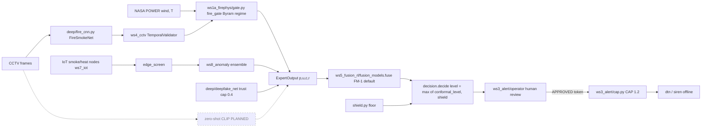
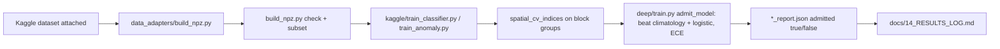
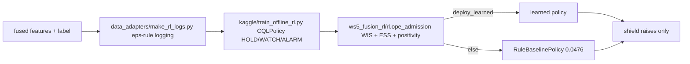
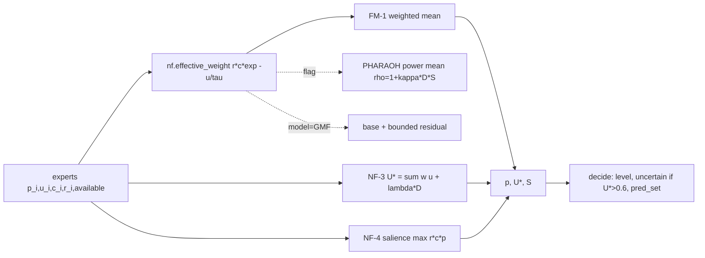
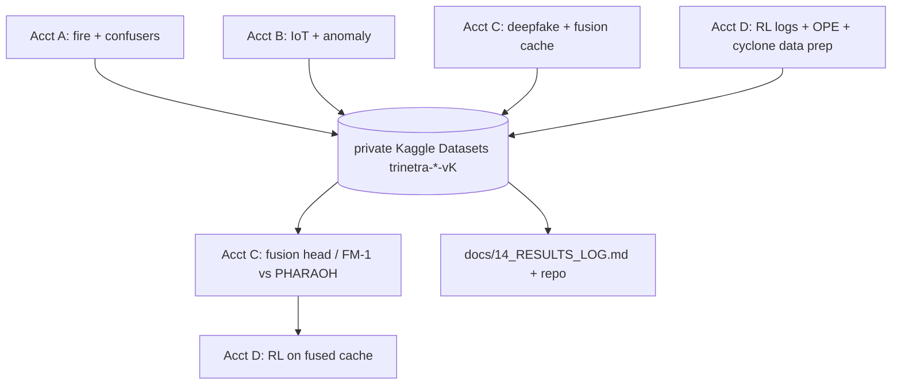
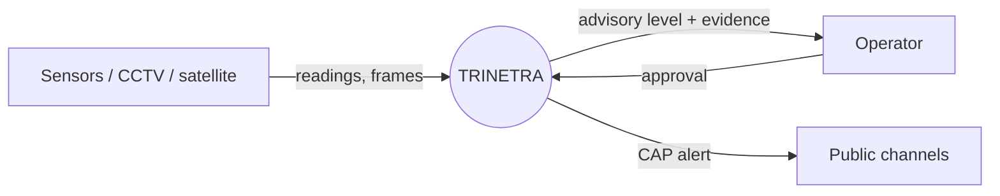
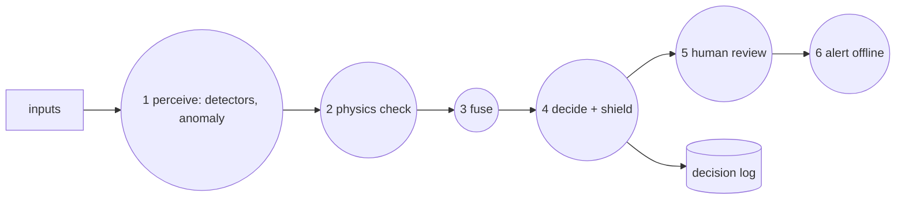

# 02 — PIPELINE FLOWCHARTS (built from code; dashed = PLANNED / not in code)
Legend: solid box = file exists and is tested here; `:::planned` dashed = not in code. Paths are relative to `trinetra/src/trinetra/`.

## (a) End-to-end inference (fire cycle)

Hinglish: Camera aur IoT do alag "gawah" (witnesses) hain. Har gawah apni probability `p`, shak `u`, physics se
mel `c` aur bharosa `r` deta hai. Fusion sab ko weight karke ek risk banata hai. Decision function us risk ko
GREEN/YELLOW/ORANGE/RED me badalta hai, aur shield sirf level **badha** sakta hai, ghata nahi. Last me insaan
(operator) approve kare tabhi CAP alert jaata hai. Zero-shot box dashed hai kyunki code me abhi nahi hai.

## (b) Training (per module, Kaggle)

Hinglish: Pehle data ko code ke format me badlo (adapter). Phir group-wise folds par train karo. `admit_model`
ek "gatekeeper" hai: agar model simple baselines ko CI ke saath nahi harata, to report me `admitted=false`.

## (c) RL loop (offline, one-step)

Hinglish: RL yahan "online game" nahi khel raha. Ye purane logged decisions se seekhta hai (offline). Agar
OPE gate bole ki naya policy rule-baseline se behtar nahi hai, to rule-baseline hi chalega.

## (d) Meta-fusion data flow

## (e) Kaggle parallel workflow

## (f) DFD Level 0 and Level 1

<!-- END -->
