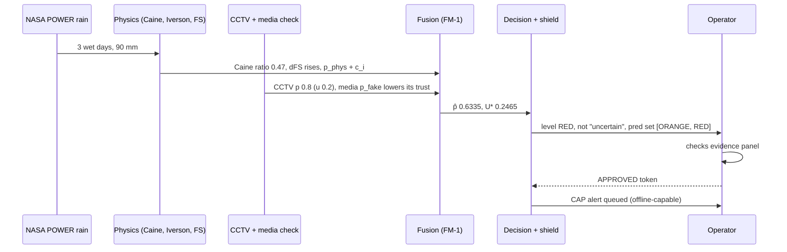

# CH01 — BIG PICTURE

**Simple me samjho:** TRINETRA ek "teen aankhon wala chowkidaar" hai. Pehli aankh dekhti hai (camera, satellite, weather). Doosri aankh physics se poochhti hai
"kya ye sach me ho sakta hai?". Teesri aankh batati hai "main kitna sure hoon". Phir ek insaan faisla karta hai ki public alert jaaye ya nahi.

**Ek se zyada model kyun?** Ek camera dhuan aur bhaap me confuse ho sakta hai, aur barish ka ek number slope ki taakat nahi jaanta. Kai saboot milkar galti kam
karte hain (jaise doctor ek test par nahi, kai tests par diagnosis karta hai).

**Uncertainty kyun?** Mausam vibhag "70% barish" bolta hai, "barish hogi" nahi. Hum bhi probability aur uncertainty dete hain, aur jab saboot aapas me
ladte hain to system khud bolta hai "needs human review".

## Pipeline
See docs/02_PIPELINE_FLOWCHARTS.md (a) and deck slide 2: sources → adapters → experts (p, u) → physics (c, FS floor) → fusion (p̂, U*) →
decision (level, uncertain) → human → CAP alert; RL advises.

## Story of one alert (worked example with repo numbers; not a field event)

Hinglish: barish ka data physics me gaya, camera ki raay fusion me gayi, fusion ne 0.63 risk aur kam uncertainty di, isliye level RED hua. Lekin alert tabhi
gaya jab operator ne approve kiya. Numbers CH08 worked example se hain.

**Self-check:** (1) Shield level ghata sakta hai? (Nahi, sirf badha sakta hai.) (2) Alert kaun bhejta hai? (Operator, approval token ke saath.)
<!-- END -->
