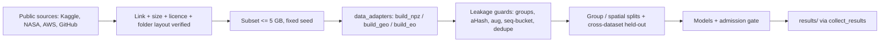

# CH03 — DATASETS: kaunsa aur kyun

**Simple me samjho:** model ek student hai aur dataset uski kitaabein. Terabytes ki library 36 ghante me nahi padh sakte, isliye humne
chhoti, free aur jaanchi hui kitaabein li. Exam (test) alag kitaab se, taaki yaad karke pass na ho.

## Dataset flow

Hinglish: har dataset pehle verify hota hai (link, size, licence, andar ke folders), phir adapter usse code ke format me badalta hai, phir leakage guards
lagte hain, aur tab hi model dekhta hai.

## Dataset cards (short; full rows in docs/09b_dataset_links.csv)
| Dataset | Module | Kyun chuna | Subset | Labels | Problem → humne kya kiya |
|---|---|---|---|---|---|
| D-Fire (Kaggle mirror) | fire CNN | 21k surveillance + web images, fire AND smoke | 4,000 @128 px | YOLO boxes → [fire, smoke] | class ids not in README → read `data.yaml`; AoF frames consecutive → seq-bucket 50 |
| DeepFire | held-out | alag source, forest | 1,520 | fire / nofire | web duplicates with D-Fire → `dedupe` |
| FIRE Dataset | held-out 2 | outdoor web photos | 999 | fire / non-fire | imbalance 3:1, reported |
| FireSense | video | 49 real videos, temporal test | every 10th frame | pos / neg | small n → counts reported |
| Weather, small flames, Intel scenes | stress | fog, dust, candles, normal scenes = false-alarm tests | ≤ 600 per set | treated as NOT fire | candles are real flames → stress only, never training |
| CIFAKE, StyleGAN faces, AI-vs-real art | media check | train + 2 different generators held-out | 32 px | real / fake | faces `_aug_` copies → grouped; faces never shown |
| NASA Global Landslide Catalog | landslide | real dated Indian events, free | 184 events (29-33N, 76-81E) | event day | controls = same place, other monsoon days (case-control) |
| NASA POWER | rain forcing | no login, daily | 0.5° cells | mm/day | smooths cloudbursts → IMERG later |
| Copernicus DEM GLO-30 | slope | 30 m, open on AWS | 14 tiles | elevation | radar voids on cliffs (known) |
| Landslide4Sense | EO S2 | 14 bands incl. Kodagu (India) | 3,799 patches | masks → patch label | no coordinates → hash groups |
| Sen1Floods11 | EO S1 | hand-labelled SAR floods | all hand-labelled | water masks | group = event; Bolivia held-out |
| Hephaestus | InSAR | 19,919 annotated interferograms (MIT) | ≤ 5,000 | deformation yes/no | group = frameID |
| ICIMOD HMAGLOFDB v4 | GLOF | 766 Himalayan GLOF records | all | area, volume, discharge | many blanks (n 21-31 usable) |

## Roles
Train: D-Fire, CIFAKE, L4S, Sen1Floods11 (non-Bolivia), Hephaestus. Held-out: DeepFire, FIRE Dataset, StyleGAN faces, AI art, Bolivia, home fire.
Stress: weather, small flames, Intel scenes. Physics evaluation: GLC + POWER + DEM, HMAGLOFDB. Video: FireSense.

## Kyun terabytes nahi
Full benchmarks (e.g. SSL4EO 1.5 TB, FASDD, ShanghaiTech) don't fit 36 h or Kaggle disks. Consequence: **our numbers are on subsets and
are NOT comparable to full-benchmark papers.** Every results table says so.

**Common galti:** same video ke frames ko random split karna. **Self-check:** (1) Candle dataset training me kyun nahi? (stress only, flame ≠ hazard)
(2) Bolivia alag kyun? (dataset ka standard cross-region test) (3) Case-control me value score headline kyun nahi? (base rate artificial).
<!-- END -->
