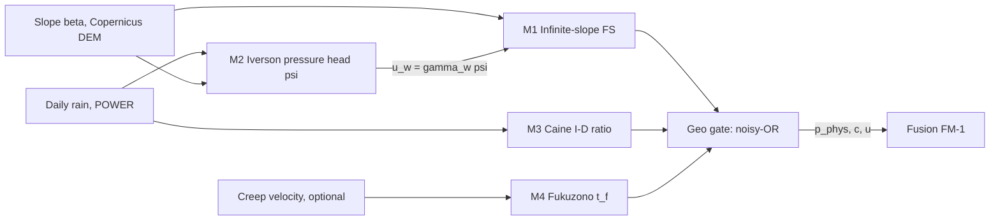

# CH05A — Landslide physics: har formula shuru se derive (Hinglish)

> **Physics bilkul zero se?** Beginner-level book (derivations, misaal, worked examples, kamiyaan, figures): [`PHYSICS_FROM_ZERO/P00_START_HERE.md`](PHYSICS_FROM_ZERO/P00_START_HERE.md).

Har derivation code se match karti hai (file path diya hai). Class A = established, B = humne A se derive kiya, C = hypothesis.
Har model ke end me ek hand-computed example hai (numbers repo ki default values se). Example result nahi hai, sirf samjhane ke liye.

## M1 · Infinite-slope Factor of Safety  [A]  `ws1b_geophys/fs.py`
**Idea (analogy):** dhalaan par rakhi ek lambi mitti ki chadar. Gravity use neeche kheenchti hai, friction aur cohesion rokte hain.
FS = rokne wali taakat / kheenchne wali taakat. FS < 1 matlab slip.

**Derivation**
1. Ek slab lo, vertical gehraai `z`, dhalaan `β`, unit weight `γ`. Unit *plan* area ka weight = `γ z`.
2. Slip surface slope ke parallel hai. Unit *slope* area par weight `γ z cos β` aata hai (area `1/cos β` guna bada hota hai).
3. Is weight ko surface ke perpendicular aur parallel me todo:
   normal stress `σ = γ z cos²β`, shear stress `τ = γ z sin β cos β`.
4. Paani pores me pressure `u_w` deta hai jo grains ko alag dhakelta hai. Effective normal stress `σ' = γ z cos²β − u_w` (+ suction `σ_s`, jo saturation par 0 ho jaata hai).
5. Mohr–Coulomb strength: `τ_f = c' + σ' tan φ'`.
6. FS = strength / driving stress:

$$FS = \frac{c' + (\gamma z\cos^2\beta - u_w + \sigma_s)\tan\phi'}{\gamma z \sin\beta\cos\beta}$$

**Units:** numerator aur denominator dono kPa → FS dimensionless. ✓
**Limiting cases:** dry, `c'=0`, `u_w=0` → `FS = tan φ' / tan β` (classic "angle of repose" rule: β > φ' to fail). `u_w` badhe → FS ghate. ✓ (golden tests)

| symbol | meaning | unit | repo default |
|---|---|---|---|
| c' | effective cohesion | kPa | 5 (ASSUMPTION) / back-analysed |
| φ' | friction angle | deg | 32 (ASSUMPTION) |
| γ | soil unit weight | kN/m³ | 19 |
| z | slip depth | m | 2 |
| β | slope angle | deg | DEM p90 |
| u_w | pore pressure | kPa | from M2 |

**Example (hand-computed):** β=30°, φ'=32°, γ=19, z=2, c'=5.
Denominator = 19·2·0.5·0.866 = 16.45 kPa. Dry: σ'=38·0.75=28.5 → 5+28.5·0.625=22.81 → **FS=1.39**.
With ψ=0.5 m → u_w=9.81·0.5=4.91 kPa → σ'=23.60 → 5+14.75=19.75 → **FS=1.20**.

## M2 · Iverson / TRIGRS transient pressure head  [A]  `ws1b_geophys/iverson.py`
**Idea:** baarish ka paani ek "pressure wave" ki tarah zameen me neeche diffuse hota hai, jaise garam chai ka heat chammach me.

**Derivation**
1. Richards equation (unsaturated flow) ko wet initial condition aur short time ke liye linearize karo → diffusion equation:
   $$\frac{\partial\psi}{\partial t} = D_1\frac{\partial^2\psi}{\partial Z^2},\qquad D_1=\frac{D_0}{\cos^2\beta}$$
   Slope **sirf** `D1` ke through aata hai (code ka bug-guard: koi extra `cos β` factor nahi).
2. Surface boundary: rain flux `I_z ≤ K_z` (zyada baarish runoff ban jaati hai). Darcy se surface gradient `−∂ψ/∂Z = I_z/K_z`.
3. Semi-infinite domain, constant-gradient boundary ka standard solution:
   $$\psi(Z,t)=\frac{I_z}{K_z}\,R(Z,t),\quad R=\sqrt{4D_1t}\;\mathrm{ierfc}\!\left(\frac{Z}{\sqrt{4D_1t}}\right)$$
   `ierfc(x) = e^{−x²}/√π − x·erfc(x)`.
4. **Check:** `d ierfc/dx = −erfc(x)` → `∂R/∂Z|₀ = −erfc(0) = −1` → `−∂ψ/∂Z = I_z/K_z`. Boundary satisfied. ✓
5. Equation linear hai, isliye baarish ke steps add (superpose) hote hain:
   $$\psi=\sum_k \frac{I_k-I_{k-1}}{K_z}R(Z,t-t_k)H(t-t_k)$$
   Ek pulse [0,T]: `ψ = (I/K)[R(t) − R(t−T)]`, yaani baarish rukne ke baad recovery.
6. Physical cap (build_geo): `ψ ≤ z cos²β` (hydrostatic saturation se zyada nahi). Phir `u_w = γ_w ψ`, `γ_w = 9.81 kN/m³`.

**Units:** `D1·t` m² → `R` m; `I/K` dimensionless → ψ m. ✓  **Limit:** `t→0` → `R→0`; deep `Z→∞` → `ψ→0`. ✓
**Example:** D0=5e-5 m²/s, β=30° → D1=6.67e-5. t=1 day → √(4D1t)=4.80 m; Z=2 → x=0.417, ierfc≈0.243 → R=1.17 m.
I=5 mm/h=1.39e-6 m/s, K_z=1e-5 → I/K=0.139 → **ψ≈0.16 m**.

## M3 · Caine rainfall intensity–duration threshold  [A, empirical]  `ws1b_geophys/caine.py`
**Idea:** chhoti baarish lambi chale ya tez baarish thodi der — dono landslide la sakti hain. Ek line in dono ko alag karti hai.
1. Empirical power law: `I_thr = a·D^{−b}` (I mm/h, D h). Log me: `log I = log a − b log D` → seedhi line.
2. Exceedance ratio: `r = I / I_thr`. `r>1` = line ke upar.
3. Code me D aur I (`build_geo.physics_features`): D = lagataar wet days (≥1 mm) × 24 h; I = un dino ki total baarish / D.
4. Repo constants a=14, b=0.39 global hain → locally re-fit karna zaroori (honesty note).

**Example:** D=24 h → I_thr = 14·24^{−0.39} = 4.05 mm/h. 120 mm in 24 h → I=5 → **r=1.23** (exceeded).
**Result [C3]:** zero-fit Caine ratio ROC-AUC 0.758 on 736 real rows (`results/geo_large`).

## M4 · Fukuzono / Voight inverse velocity  [A/B]  `ws1b_geophys/fukuzono.py`
**Idea:** failure se pehle creep tez hota jaata hai; speed ka ulta (1/v) seedhi line me zero ki taraf jaata hai.
1. Voight law: `dv/dt = A v^α`.
2. Separate karke integrate: `∫v^{−α}dv = A∫dt` → `v^{1−α}/(1−α) = A t + C`.
3. Failure time `t_f` par `v→∞` → `v^{1−α}→0` (α>1) → `v^{1−α} = A(α−1)(t_f − t)`.
4. α=2: `1/v = A(t_f − t)` → t ke saath linear. Fit `1/v = m t + b` → **`t_f = −b/m`**.
5. Code improvements: recency-weighted least squares (latest points zyada weight), aur delta method se uncertainty:
   gradient `g = (−t_f/m, −1/m)` w.r.t. (m,b), `Var(t_f)= gᵀ Σ g`, interval `t_f ± 1.96·SE`.
**Example:** 1/v = 10 − 0.5 t → t_f = 20 h. **Status:** no creep data in repo → not tested on real data.

## M5 · Geo gate (combining the physics)  [B, design]  `ws1b_geophys/gate.py`
1. `p_fs = σ(k(1−FS))`, k=4 → FS=1 par 0.5, FS<1 par >0.5.
2. `p_caine = clip(r − 0.5, 0, 1)`.
3. `p_fk = clip(1 − lead/48 h, 0, 1)·R²` (lead = t_f − now).
4. Noisy-OR: `p_phys = 1 − Π(1 − p_i)` → monotone, kabhi under-warn nahi karta.
5. Consistency `c = 1 − std(active p_i)`; uncertainty `u = 0.5(1−c) + 0.1`. Ye fusion me jaata hai.

## Derived B-formulas used on real data
- **ΔFS (c'-free rain signal):** FS_dry − FS_wet = `γ_w ψ tan φ' / (γ z sin β cos β)`. `c'` cancel ho jaata hai, isliye unknown soil ka bias hat jaata hai. ψ→0 → 0. ✓ Example: 4.91·0.625/16.45 = **0.186** (M1 ke 1.39 − 1.20 se match). ROC-AUC 0.750 [C3].
- **Back-analysed cohesion:** maan lo dry slope khada hai with FS=1.2 → `c' = 1.2 γ z sin β cos β − γ z cos²β tan φ'`, clip ≥ 0. Ye "dry Himalaya par FS<1" wala flaw theek karta hai (B-23).

**Common mistakes:** (1) slope ko `D1` ke alawa bhi lagana; (2) Caine a,b ko local truth maan lena; (3) absolute FS ko calibrated maanna (soil ASSUMED hai) — isliye ΔFS use karte hain.
**Self-check:** ψ dugna ho to ΔFS kitna badlega? (Jawab: dugna, linear hai.)

<!-- END -->
