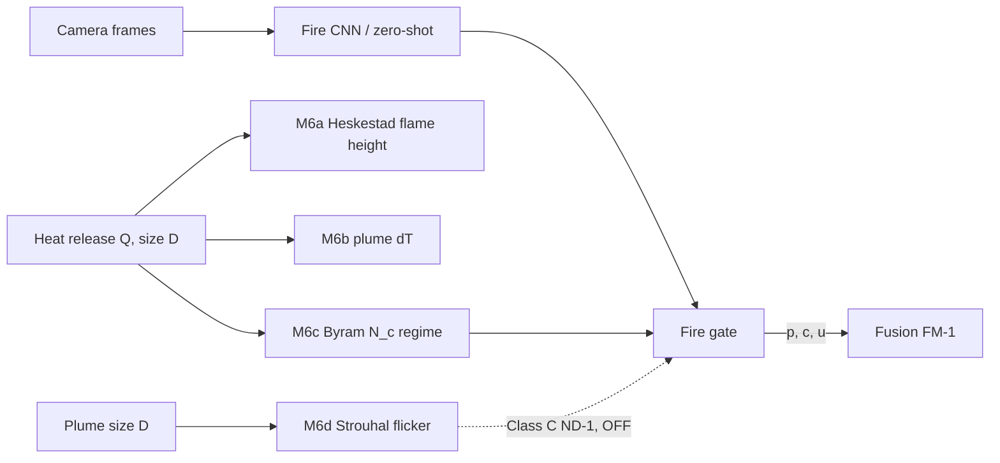

# CH05B — Fire physics + Geo-PINN: derivations (Hinglish)

> **Physics bilkul zero se?** Beginner-level book (derivations, misaal, worked examples, kamiyaan, figures): [`PHYSICS_FROM_ZERO/P00_START_HERE.md`](PHYSICS_FROM_ZERO/P00_START_HERE.md).

Fire formulas `ws1a_firephys/established_ef.py` se, Geo-PINN `deep/geo_pinn.py` + `deep/losses.py` se. Fire coefficients `[coeff-verify]`
hain: primary source (SFPE / Heskestad / McCaffrey) se confirm hone tak inhe live truth nahi maana jaata.

## M6a · Heskestad flame height  [A]
**Idea:** jitni zyada aag ki power (Q), utni oonchi flame; bada pool (D) flame ko "chapta" karta hai.
1. Dimensional analysis: flame height ratio `L/D` sirf dimensionless heat release par depend kare:
   `Q* = Q / (ρ∞ c_p T∞ √g · D^{5/2})`.
2. Experiments: `L/D = 3.7 Q*^{2/5} − 1.02`.
3. Q* daalo: `Q*^{2/5} = Q^{2/5} (ρ c_p T √g)^{−2/5} D^{−1}` (kyunki `(D^{5/2})^{2/5} = D`).
4. Dono taraf D se guna: `L = 3.7(ρ c_p T √g)^{−2/5} Q^{2/5} − 1.02 D`.
5. Ambient values (ρ=1.2, c_p=1.0 kJ/kgK, T=293 K, √g=3.13) → constant ≈ 0.22–0.235; code `0.235` (Q kW, L m).
$$L = 0.235\,Q^{2/5} - 1.02\,D$$
**Example:** Q=500 kW, D=0.5 m → 0.235·12.01 − 0.51 = **2.31 m**.

## M6b · Plume centreline excess temperature  [A]
1. Point source buoyancy flux `B = gQ/(ρ c_p T)`.
2. Similarity: height z par speed `w ~ (B/z)^{1/3}`, aur `ΔT/T ~ B^{2/3} z^{−5/3}/g`.
3. B daalne par: `ΔT = C (T/(g c_p² ρ²))^{1/3} Q_c^{2/3} (z − z₀)^{−5/3}`, C=9.1.
**Meaning:** height dugni → ΔT ~3.2 guna kam (2^{5/3}). Sensor kitni oonchai par hai, ye matter karta hai.

## M6c · Byram convection number (regime check)  [A]
`N_c = 2 g Q_c / (ρ c_p T U³)` = buoyant power / wind kinetic power.
`N_c > 2` → plume-dominated (asli aag jaisa); `N_c < 1` → wind-dominated. Gate consistency `c *= clip(N_c/2, 0.3, 1)` → implausible regime down-weight.

## M6d · Strouhal puffing frequency  [A]
1. Flame puffing time-scale buoyancy se: `f ~ St·√(g/D)`.
2. St ≈ 0.48 → `0.48·3.13 ≈ 1.5` → **`f ≈ 1.5 D^{−1/2}` Hz**.
**Example:** D=0.5 m → f=2.12 Hz. Steam/fog aisi regular flicker nahi dete — isliye ye useful check hai.

## M6e · Radiation helpers  [A]
Gray-body `L = ε σ_SB T⁴` (inverse `T = (L/εσ)^{1/4}`); smoke transmittance (Beer–Lambert) `τ = e^{−(κ+σ)L}`.

## Class C (default OFF, sirf soft features)
- **ND-1 de-aliased flicker:** sasta camera 2 fps par 2.12 Hz ko `|f − f_s·round(f/f_s)| = 0.12 Hz` jaisa dikhata hai. Consistency `exp(−(f_obs − f_alias)²/2σ²)`, σ=0.3 Hz.
- **ND-2 smoke-transmittance temperature:** `L_obs = τB(T_fire) + (1−τ)B(T_smoke)` → `B(T_fire)` solve. Error `dT = dL/(4εσT³)`, `dL = 0.05 L/τ` → τ→0 par uncertainty phat jaati hai (fail-safe to "uncertain").
- **ND-3 ignition index:** `Π = Σ w_i·scale_i·rate_i` (≥0). Small boost only.
**Status:** novelty not verified; untested; OFF.

## Fire gate summary  `ws1a_firephys/gate.py`
`p = detector_conf` (+0.1·tanh(Π) agar ND-3 ON); `c` Byram/ND-1 se, IoT agreement par +0.1; `u = 0.15 + 0.4(1−c) + extra_u`. Gate kabhi public alarm nahi bhejta.

## M7 · Geo-PINN (trained physics model)  [B]  `deep/geo_pinn.py`
**Idea:** network `ψ_θ(Z, t, rain, static)` seekhta hai, par use Iverson equation follow karni padti hai. Labels kam hon to bhi physics "dense" supervision deti hai.
1. **PDE residual** (autograd se derivatives): `r = ∂ψ/∂t − D1 ∂²ψ/∂Z²`.
2. **Physics → FS:** `u_w = γ_w·max(ψ,0)`, phir differentiable M1 formula se FS.
3. **Risk head:** `[ψ, tanh ψ, FS, static] → logit → p`.
4. **Loss:**
   $$\mathcal{L} = \lambda_d\,\mathrm{BCE}(p,y) + \lambda_p\Big[\overline{r^2} + 0.5\,\overline{\mathbb 1[FS<1](1-p)^2}\Big]$$
   λ_d = λ_p = 1. Hinge ka matlab: agar physics kehti hai unstable (FS<1), to risk kam batana mehenga hai.
5. **Units fix (B-28):** inputs O(1) rakhne ke liye t days me, rain mm/h, aur `D0' = 5e-5·86400 = 4.32 m²/day` → PDE same rehta hai.
6. **Collapse fix (B-27):** constant c'=5 se har jagah FS<1 → hinge sabko "high risk" bana deta. Back-analysed c' use kiya.
**Code note (gap):** `physics_weight` `physics_loss` ke andar aur `geo_pinn_step` me dobara lagta hai (λ_p²). Default 1.0 par koi asar nahi; agar badlo to dhyan rakho.
**Result [C3, NOT admitted]:** spatial OOF ROC-AUC 0.716, ECE 0.099 (`results/geo_pinn`). Ye zero-fit Caine (0.758) aur rain logistic (0.781) se kam hai → deploy nahi.

## 7 physics models ka summary
| # | model | class | trainable? | real-data status |
|---|---|---|---|---|
| M1 | Infinite-slope FS | A | no (soil ASSUMED / back-analysed) | used in ΔFS, gate |
| M2 | Iverson/TRIGRS | A | no | used (real POWER rain) |
| M3 | Caine I-D | A | a,b refit possible | AUC 0.758 [C3] |
| M4 | Fukuzono | A/B | fitted per slope | no creep data |
| M5 | Geo gate | B | no | AUC 0.712 [C3] |
| M6 | Fire physics (Heskestad, plume, Byram, Strouhal) | A | no | golden tests only |
| M7 | Geo-PINN | B | **yes** | AUC 0.716, not admitted |

**Self-check:** Strouhal se D=2 m pool ki flicker? (Jawab: 1.5/√2 ≈ 1.06 Hz.)

<!-- END -->
